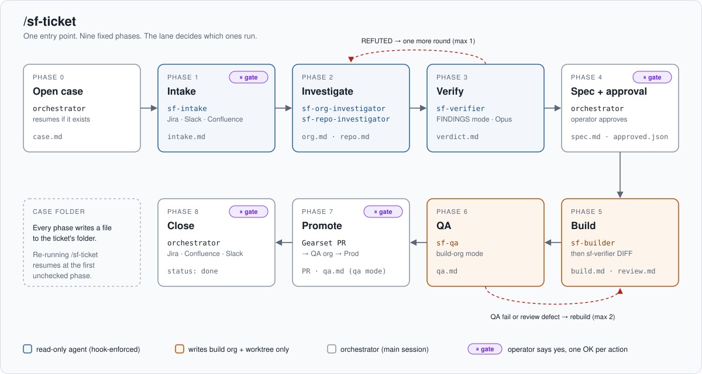
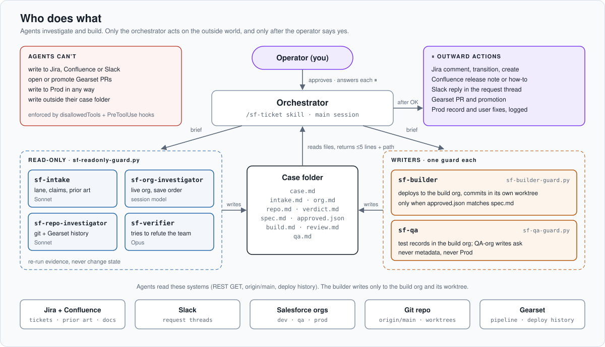
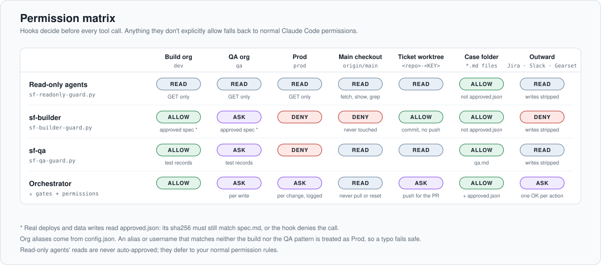
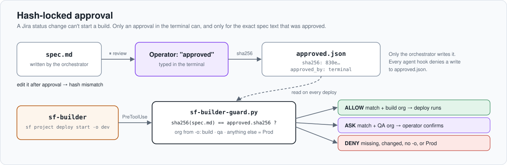
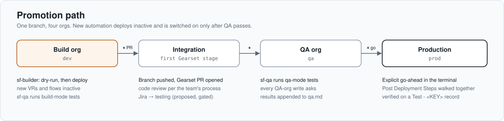

# Salesforce Agentic SDLC

**A gated, multi-agent software delivery loop for Salesforce, built on Claude Code.**

One command, `/sf-ticket <KEY>`, takes a Salesforce request from a Jira ticket, a Slack thread,
or pasted text and runs it through the same loop every time. The loop covers intake,
investigation, adversarial verification, spec, build in a sandbox, QA, promotion through Gearset,
and close-out in Jira, Confluence and Slack. Six specialised agents do the work. Hooks written in
Python, not prompt instructions, decide what each agent is allowed to touch, and a human approves
every outward or irreversible step.

I built this to run my own Salesforce admin and developer queue: support tickets, config
changes, automation bugs and GTM launch specs. Everything company-specific lives in two config
files, so the workflow moves between orgs unchanged.



## Why it's built this way

Most "AI does the ticket" demos let one agent read, decide and change things in a single pass.
In a production CRM, that's how an unreviewed validation rule ends up blocking most edits on a
busy object. This design pulls those steps apart:

- **Find is separate from fix.** Four agents are read-only, enforced by a hook. Only
  `sf-builder` changes metadata, and only in the build sandbox and its own git worktree.
- **Guardrails are code.** PreToolUse hooks classify every `sf`, `git` and file operation and
  return allow, ask or deny. The rules are covered by a test suite.
- **Approval is a hash.** The spec is approved in the terminal. Its SHA-256 goes into
  `approved.json`, and the builder's hook refuses to deploy if the spec changed afterwards.
- **A verifier tries to prove the team wrong.** It re-runs every query itself and grades each
  claim CONFIRMED, PLAUSIBLE or REFUTED before any spec is written.
- **Files, not chat.** Every ticket has a case folder. Agents write findings there and return
  five lines plus a path, so any phase can be resumed and the folder is the audit trail.

## Who does what



| Agent | Role | Model | Writes |
|---|---|---|---|
| **orchestrator** (`/sf-ticket` skill) | Runs the phases, briefs agents, asks the operator at every ⏸ | session | `case.md`, `spec.md`, `approved.json`, Prod fixes after an OK |
| `sf-intake` | Lane, falsifiable claims, acceptance criteria, missing info, prior art from Jira and Confluence | Sonnet | `intake.md` |
| `sf-org-investigator` | Live org state: automation in save order, active flow versions, FLS, users, audit trail | session | `org.md` |
| `sf-repo-investigator` | Source on `origin/main`, change history, Gearset deployments, repo-vs-org drift | Sonnet | `repo.md` |
| `sf-verifier` | FINDINGS mode grades the evidence; DIFF mode reviews the build against the spec | Opus | `verdict.md`, `review.md` |
| `sf-builder` | Builds the approved spec in a worktree, deploys to the build org inactive, commits | session | `build.md`, metadata |
| `sf-qa` | Derives falsifiable test cases, runs them in the build org and then the QA org | session | `qa.md`, test records |

## Guardrails





The hooks live in [`hooks/`](hooks). They split each Bash command into segments, classify every
segment, and the most restrictive decision wins. Any org alias that isn't recognised as the
build or QA org is treated as Prod, so a typo fails safe.

```bash
python3 -m unittest discover tests -v   # 9 tests, 48 allow/ask/deny assertions
```

## Lanes

The orchestrator proposes a lane at intake and the operator confirms it. The lane decides which
phases run.

| Lane | Typical request | Runs | Builds? |
|---|---|---|---|
| **support** | "I can't see X", a data fix, a user to mirror, an urgent error | intake → investigate by type → fix now, backlog, or urgent temporary fix | No. Prod fixes are made by the orchestrator after an OK |
| **explain** | "Why does X happen?" | intake → org + repo → answer citing tickets, Confluence and metadata | No |
| **change** | Field, picklist, FLS, layout, validation rule, simple flow | full loop | Yes |
| **bug** | Automation stopped working | full loop; verification is mandatory | Yes |
| **gtm** | SKU or pricing launch work | intake → investigate → impact and architecture spec | No |

## Promotion



## What's in the repo

```
skill/sf-ticket/
  SKILL.md                    orchestrator playbook (phases, gates, brief template)
  config.example.json         paths + org aliases the hooks enforce
  references/
    org-profile.example.md    the one file you rewrite per company
    lanes.md                  lanes, support types, outcomes, missing-info checklist
    sf-gotchas.md             30 Salesforce rules, each learned from a real incident
    query-recipes.md          read-only REST / Tooling queries for every question
  templates/                  case, findings, bug + change specs, support plan, reply, QA report
agents/                       six subagent definitions (tools, model, hook wiring)
hooks/                        readonly / builder / qa guards + shared library
tests/                        hook test suite
examples/SF-142-…/            a complete fictional case folder, phase by phase
docs/                         setup, porting to a new company, design decisions
install.sh
```

The [example case](examples/SF-142-opportunity-region-blank) shows every artifact from one
fictional bug. The verifier confirms the root cause and refutes one of the requester's claims,
then the change is built, QA'd and promoted.

## Requirements

Claude Code, the Salesforce CLI (`sf`) authenticated to a build sandbox, a QA sandbox and Prod,
a Salesforce source repo in git deployed with **Gearset**, and MCP connectors for
**Jira + Confluence** (Atlassian), **Slack** and **Gearset**. Python 3.9+ for the hooks.

## Quick start

```bash
git clone https://github.com/<you>/salesforce-agentic-sdlc.git
cd salesforce-agentic-sdlc
./install.sh
```

Then fill in `~/.claude/skills/sf-ticket/config.json` and
`~/.claude/skills/sf-ticket/references/org-profile.md`, restart Claude Code, and run:

```
/sf-ticket SF-123
```

See [docs/setup.md](docs/setup.md), [docs/customizing.md](docs/customizing.md) and
[docs/design-decisions.md](docs/design-decisions.md).

## Status

v1 has been used on real support, change and bug tickets. Not built yet: unattended intake
runs, builds for the gtm lane, and a dashboard built from case-file frontmatter.

## License

MIT
